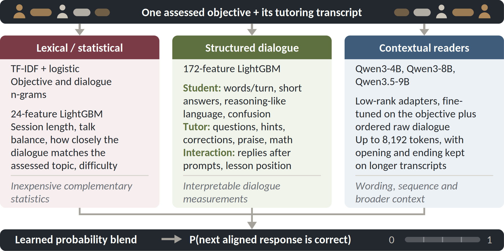
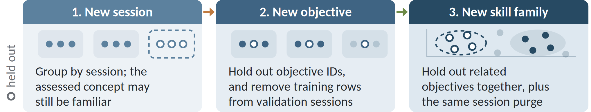

# ace-reader

**Participant: MPWARE**

**Solution - Trace the Ace: Tutoring Outcomes Prediction Challenge.** LLM transcript readers
plus a tabular stack that predict whether a student masters the objective of a tutoring lesson.

## Quick start

Linux with an NVIDIA GPU (>= 40 GB; tested on 80-96 GB), driver >= 575, a C compiler, ~90 GB free
disk. Put the competition files in `data/` (see Setup, step 3).

**1. Inference with the shipped weights**, about 10 min for the dry run and ~3 h 40 min for the full test set:
```bash
curl -O https://s3.amazonaws.com/cytologia/ace-reader.zip && unzip ace-reader.zip && cd ace-reader
bash envs/setup_envs.sh inference && source .venv-inference/bin/activate
python scripts/download_weights.py                                   # 44.5 GB, verified

# quick check on 300 training sessions (no test set needed):
python scripts/make_dryrun_data.py --data-dir data --out data_dryrun --sessions 300
DATA_DIR=data_dryrun bash scripts/run_inference.sh

# full submission:
DATA_DIR=data bash scripts/run_inference.sh                          # -> submission/submission.csv
```

**2. Training (optional)**, from raw training data to every model asset:
```bash
deactivate && bash envs/setup_envs.sh tabular llm qwen35
DATA_DIR=data bash scripts/run_training.sh 0 1 2 3 4    # base models + tabular models, ~2-3 h
DATA_DIR=data bash scripts/run_training.sh              # all stages 0-9, ~220 GPU-hours
```
The output is `outputs/staging/`, with the same layout as `inference/`. Details: Setup, Run inference, Run training.

## Overview

For one assessed learning objective and the tutoring transcript that precedes it, the model
predicts the probability that the student's next aligned assessment response is correct.
Almost every objective in the test set is new, so the solution is built and validated for
skills it has never seen.

Six models give three complementary views of the same objective-plus-dialogue evidence, and
a learned probability blend combines them:



*Figure 1. Final ensemble architecture. The structured branch keeps student and tutor
behaviours inspectable; the contextual readers keep the ordered language and broader
context.*

- **Lexical / statistical** (inexpensive complementary statistics): TF-IDF + logistic
  regression on objective and dialogue word n-grams, blended 50/50 with a 24-feature
  LightGBM (session length, talk balance, how closely the dialogue matches the assessed
  topic, objective difficulty), then Platt-calibrated. Input `z_blend`.
- **Structured dialogue** (interpretable dialogue measurements): a 172-feature LightGBM
  over six feature families: student response (words per turn, short answers,
  reasoning-like language, confusion), tutor behaviour (questions, hints, corrections,
  praise, mathematical talk), tutor-student interaction (replies after prompts), dialogue
  structure (turn-taking, lesson position), target alignment, and objective context.
  It uses no outcome-derived objective history. Input `z_tabv2`.
- **Contextual readers** (wording, sequence and broader context): Qwen3-4B, Qwen3-8B and
  Qwen3.5-9B with low-rank adapters (LoRA), fine-tuned on the ordered raw dialogue followed
  by the objective and the question *"will the student answer correctly? Yes or No"*. Inputs
  are up to 8,192 tokens, keeping the opening and the ending on longer transcripts. Each
  reader's score is the log-odds of answering Yes rather than No. Inputs `z_ft_4b`,
  `z_ft_8b`, `z_ft_q35`.
- **Learned probability blend**: a logistic regression on the logits of the three views,
  fitted on pooled out-of-fold predictions. Qwen3-8B and Qwen3.5-9B share one slot with
  equal weight. Details in [Summary](#summary).

## Validation: new sessions, new objectives, new skill families

The test set assesses objectives the models have never seen, so the cross-validation folds
were redesigned twice until they asked the same question:



*Figure 2. Validation evolved from new sessions to exact new objectives to semantic skill
families, with validation-session purging in the latter two schemes.*

1. **New session**: folds grouped by session. The held-out sessions are new, but their
   objectives, and so the assessed concepts, still appear in training.
2. **New objective**: folds grouped by learning-objective ID, with every training row whose
   session also appears in the validation fold removed. A session usually assesses several
   objectives, so without this purge the same transcript would sit on both sides. Near-twin
   objectives (same skill, different ID) still leak.
3. **New skill family (used for everything)**: objectives are clustered by meaning, as
   connected components of the BAAI General Embedding (BGE) similarity graph at cosine
   ≥ 0.90 (398 objectives → 286 groups), and whole clusters are held out together, with the
   same session purge. A validation fold then holds no twin or sibling of a training
   objective: 68% related and 32% novel objectives, a test-like mix.

Each step lowered the measured scores; for the lexical/statistical blend the out-of-fold
AUROC went from 0.736 to 0.629 to 0.610. That drop is the point: only the last scheme
measures generalisation to new skills.

The skill-family folds are five folds of 5,455 / 9,268 / 2,876 / 11,334 / 6,139 validation
rows. The session purge removes 8-26% of the training rows per fold, but every row still gets
exactly one out-of-fold prediction. All model selection uses these folds: blend weight,
calibration, stack coefficients, and one LoRA adapter per fold for every reader. The
deployed readers are refitted on all rows.

Out-of-fold results on the skill-family folds (35,072 rows, log loss / AUROC):
lexical/statistical blend 0.5919 / 0.6096; structured dialogue 0.6019 / 0.5775; Qwen3-4B
0.5851 / 0.6463; Qwen3-8B 0.5837 / 0.6501; cross-fitted stack 0.5835 / 0.6398.

## Summary

The final model stacks five scores, all on the logit scale:

| input | model | what it reads |
|---|---|---|
| `z_blend` | 50/50 blend of a TF-IDF + logistic-regression model (15 = 5 folds x 3 seeds) and a LightGBM model (15 boosters) on 24 transcript/objective features, Platt-calibrated | transcript word/bigram TF-IDF (300k terms) + objective TF-IDF; session statistics; BGE objective-coverage scores; an objective-difficulty encoding with embedding-kNN backoff for unseen objectives |
| `z_tabv2` | LightGBM, 15 boosters (5 folds x 3 seeds), 172 features | richer session/discourse statistics (turn-taking, question and correction counts, timing irregularities, diarisation artefacts) and **student-side** BGE coverage of the objective; no objective-difficulty feature |
| `z_ft_4b` | Qwen3-4B + LoRA (r=16), full fit | the transcript itself |
| `z_ft_8b` | Qwen3-8B + LoRA (r=16), full fit | the transcript itself |
| `z_ft_q35` | Qwen3.5-9B + LoRA (r=16), full fit, merged into the base weights | the transcript itself |

**LLM readers.** Each reader gets one chat prompt per row: the whole transcript first
(`Tutor:` / `Student:` lines), then the learning objective and the question *"will the
student answer a post-lesson assessment question on this learning objective correctly?
Answer with Yes or No only."* Prompts are capped at 8,192 tokens; the rare longer transcript
keeps its first 30 % and its end, with an omission marker in between. The reader is
fine-tuned for one epoch on the single answer token, and at inference its score is
`log(P(Yes)/P(No))` read from the first generated token (vLLM, greedy, one token).
Putting the transcript before the objective lets rows from the same session share the
transcript prefix in vLLM's prefix cache.

**Stack.** The final probability is

```
z_ft_8b := 0.5 * z_ft_8b + 0.5 * z_ft_q35
p = clip(sigmoid(-0.1077 + 0.2669*z_blend + 0.1945*z_tabv2 + 0.1511*z_ft_4b + 0.4209*z_ft_8b), 0.01, 0.99)
```

- **Learned on out-of-fold predictions**: the intercept and the four coefficients are an
  unregularised logistic regression on the pooled out-of-fold logits of the skill-family
  folds (35,072 rows). So are the base blend's 50/50 weight and its Platt calibration.
- **Fixed adjustments for the LLM readers**: the deployed full-fit 4B and 8B adapters
  produce wider logits than the fold adapters the stack was fitted on, so their raw
  coefficients (0.1764, 0.4286) are scaled by x0.857 and x0.982, the fold/full-fit logit-spread
  ratios measured on a synthetic holdout none of the adapters saw (see *Logit-scale ratios*
  under Run training); Qwen3.5-9B, trained only as a full fit and so without out-of-fold
  predictions, takes no learned weight and shares the 8B slot 50/50.

## Package layout

```
inference/           the scored submission, file for file (main.py + assets/; the 15 weight files come from the weights ZIP)
  main.py            inference entry point used by the competition runtime
  assets/            models, configs, and the `ace` modules main.py imports
src/ace/             training code (an installable package: `pip install -e .`)
scripts/
  run_inference.sh   inference entry point (wraps inference/main.py)
  make_dryrun_data.py  test-format sample of training sessions, for a timed dry run
  run_training.sh    training entry point (stages 0-9)
  download_weights.py  downloads the weights ZIP, extracts + verifies the 15 weight files
  make_weights_archive.py  builds that ZIP from a verified inference/assets/ (author side)
  make_release_zip.py  builds the code release archive ace-reader.zip + RELEASE_INFO.json (author side)
  fit_stack_sub9.py  re-derives assets/llm_stack.json from out-of-fold predictions
  stage_tabular_v2.py, stage_llm.sh, export_qwen35_full_merged.py, compare_synth_holdout.py
  gen_synth/         synthetic-holdout pipeline (run_pilot.sh, synth_holdout_8b.sh + stages), code only
envs/                pinned requirements per environment + setup_envs.sh
models/weights_manifest.json   every file of the scored archive (size, CRC32) + the weights ZIP (URL, size, SHA-256)
tests/               CPU-only checks (pytest); see Reproducibility checks
```

No competition data is distributed: no transcripts, labels, out-of-fold predictions or fold
assignments. Training regenerates all intermediate files from the official competition
data (see Run training).

# Setup

0. **Get the code**: download the release archive (~40 MB) and unzip it:
   ```bash
   curl -O https://s3.amazonaws.com/cytologia/ace-reader.zip
   unzip ace-reader.zip && cd ace-reader
   ```
   `RELEASE_INFO.json` records the exact source revision and the SHA-256 of every file.
1. **System**: Linux x86_64, NVIDIA driver supporting CUDA 12.9 (driver >= 575), Python 3.12
   (`setup_envs.sh` uses uv's managed CPython 3.12, so no system Python is needed), a C
   compiler (`gcc`, e.g. `sudo apt-get install build-essential`; Triton compiles a helper at
   the first vLLM start), ~90 GB free disk for the weights download (peak; ~45 GB afterwards;
   training needs more, see below). Tested target: a single-GPU VM with an 80-96 GB GPU
   (e.g. RTX 6000 Pro 96 GB).
2. **Install [uv](https://docs.astral.sh/uv/)** and create the environments:
   ```bash
   bash envs/setup_envs.sh inference                 # inference only
   bash envs/setup_envs.sh tabular llm qwen35        # training (optional)
   ```
   | env | used for | key pins |
   |---|---|---|
   | `inference` | `run_inference.sh` | torch 2.11.0+cu129, vLLM 0.21.0, transformers 4.57.6, lightgbm 4.6.0 - the competition runtime's own versions (`drivendataorg/tutoring-outcomes-runtime`, `runtime/uv.lock`) |
   | `tabular` | training stages 0-4, 8 | scikit-learn 1.7.2, lightgbm 4.6.0, sentence-transformers 5.2.2, torch 2.9.0+cu128 |
   | `llm` | Qwen3-4B/8B training + OOF scoring | transformers 4.57.6, peft 0.19.1, vLLM 0.21.0 |
   | `qwen35` | Qwen3.5-9B training + merge | transformers 5.15.0, peft 0.19.1, flash-linear-attention (pinned commit) |

   Alternatively, inference can run unchanged inside the official runtime container
   (`drivendataorg/tutoring-outcomes-runtime`: `just pull`, copy `inference/` into
   `submission_src/`, `just pack-submission`, `just test-submission`).
3. **Data**: put the raw competition files in `data/` (or point `DATA_DIR` elsewhere):
   ```
   data/
     train_features.csv  train_labels.csv  train_transcripts/<session_id>.csv   # training only
     test_features.csv   submission_format.csv  test_transcripts/<session_id>.csv
   ```
4. **Weights** (44.5 GB, 15 files):
   ```bash
   source .venv-inference/bin/activate
   python scripts/download_weights.py
   ```
   All 15 weight files are published as one ZIP:

   | | |
   |---|---|
   | URL | https://s3.amazonaws.com/cytologia/ace_models_weights.zip |
   | size | 44,477,610,275 bytes (44.5 GB) |
   | SHA-256 | `d139b95dbfaf77730a6050aceadb4120042cf6ab12f9706fe2c94e38ba5fe2d2` |
   | contents | Qwen3-4B (3) and Qwen3-8B (5) base shards, the BGE export, the two LoRA adapters (Qwen3-4B, Qwen3-8B), the merged Qwen3.5-9B checkpoint (4 shards), plus `WEIGHTS_MANIFEST.json`; stored (uncompressed), same `assets/...` layout as the scored archive |

   These are the same weight files as in the scored offline submission. The script downloads
   the ZIP into `.cache/weights/` (resumable: re-run it after an interruption), checks its size
   and SHA-256, extracts the 15 files into `inference/assets/` and verifies each against the
   size + CRC32 recorded when the scored archive was built; the run fails on any mismatch.
   It then deletes the ZIP (`--keep-archive` keeps it). **Disk: ~90 GB peak, ~45 GB after.**
   - Already have the ZIP (or the scored submission ZIP, or an extracted copy)?
     `python scripts/download_weights.py --from-archive /path/to/ace_models_weights.zip`
     (an extracted folder also takes `--link` to hard-/sym-link instead of copying).
   - `--weights-url URL` (or `WEIGHTS_URL`) points at a mirror of the same ZIP.
   - `--base-from-hf` takes the 8 unmodified Qwen3-4B/8B base shards (24.4 GB) from Hugging
     Face at their pinned revisions (`1cfa9a7...`, `b968826...`; needs `huggingface_hub`) and
     reads only the other 7 files (20.1 GB) out of the remote ZIP.
   - After this step inference runs fully offline; `run_inference.sh` checks the whole tree
     with `download_weights.py --verify-only` first.

# Hardware

The solution was run on:
- **Training**: 1x 80-96 GB GPU (LLM readers); tabular models and stacking on a
  desktop machine (24 GB GPU for BGE embeddings, CPU otherwise).
- **Inference**: the competition's GPU runtime (one GPU, 6-hour limit).

Training time:
| step | time |
|---|---|
| EDA, embeddings, base blend, tabular_v2 | ~2 h |
| Qwen3-4B: 5 fold adapters (9-15 h each) + full fit | 59 h + 25 h |
| Qwen3-8B: 5 fold adapters (12-21 h each) + full fit | 82 h + 25 h |
| Qwen3.5-9B full fit | 25 h |
| stack fit, merge, staging | < 1 h |
| **total** | **~220 GPU-hours** (only the three full fits, ~75 h, produce shipped weights; the fold adapters exist to produce out-of-fold predictions for the stack) |

Inference time: about **3 h 40 min** (estimated) end to end on the competition runtime (one
80 GB GPU, ~10,500 rows), within the 6-hour limit.

| step (scored run) | time |
|---|---|
| unpack the 44.6 GB submission | 4 min |
| tabular stages 1-5 (parsing, TF-IDF, BGE, tabular_v2, LightGBM + blend) | 22 min |
| Qwen3-4B (incl. ~6 min engine start-up and CUDA-graph capture) | 49 min |
| Qwen3-8B | ~72 min |
| Qwen3.5-9B | ~72 min |

The first three rows come from the scored run's log. The platform truncates that log just
after the Qwen3-8B engine starts, so the last two rows are estimates: Qwen3-8B took 72 min on
the same runtime in an earlier submission, and Qwen3.5-9B costs about the same.
Memory: the three readers run one after another, each with vLLM at 90 % of GPU memory;
tested on 80-96 GB GPUs; >= 40 GB is recommended for the Qwen3.5-9B engine (19.3 GB of bf16
weights plus KV cache).

Verified end to end on a fresh RTX PRO 6000 (96 GB) VM from the public downloads: weights
SHA-256 and all 119 files OK; 300-session inference dry run in 7 min with all three readers;
training stage 0, LoRA smoke runs for stages 5-7, and the stage-9 merge and staging, whose
`bundle.json` is identical to the shipped one.

# Run training

```bash
DATA_DIR=data bash scripts/run_training.sh          # all stages 0-9
DATA_DIR=data bash scripts/run_training.sh 3 4 8    # e.g. only the tabular part + stack
```

| stage | env | what | writes |
|---|---|---|---|
| 0 | tabular | download base models at pinned revisions | `models/hf/` |
| 1 | tabular | EDA tables: per-session transcript statistics, objective/transcript overlap | `outputs/eda/` |
| 2 | tabular | BGE (`BAAI/bge-base-en-v1.5`) objective coverage + objective embeddings | `outputs/embeddings/`, `cache/` |
| 3 | tabular | skill-cluster CV folds; TF-IDF+LR and LightGBM base blend, weight + Platt fitted on OOF | `outputs/eda/cv_folds_skill.csv`, `outputs/staging/assets/`, `outputs/models/sub5_fit/oof.csv` |
| 4 | tabular | tabular_v2 features and 15 boosters; staged config | `outputs/models/tabular_v2_bge_no_telo/` |
| 5 | llm | Qwen3-4B LoRA on each fold (+ vLLM OOF scoring) and on all rows | `outputs/models/e13_qwen4/` |
| 6 | llm | same for Qwen3-8B | `outputs/models/e13_qwen8b/` |
| 7 | qwen35 | Qwen3.5-9B LoRA on all rows | `outputs/models/e23_qwen35_9b/full/` |
| 8 | tabular | level-2 stack fit | `outputs/staging/assets/llm_stack.json` |
| 9 | qwen35, tabular | merge the Qwen3.5 adapter into a full `Qwen3_5ForConditionalGeneration` checkpoint (the form vLLM 0.21 serves); stage all readers | `outputs/staging/` |

The staged tree has the same layout as `inference/` and runs as is:
```bash
INFERENCE_DIR=outputs/staging DATA_DIR=data bash scripts/run_inference.sh
```
(the scored-archive weights check is skipped for a retrained tree; `main.py` and
`assets/llm_stack.json` must be present).

Notes:
- **Data sources**: only the competition's training files. Network access is needed for
  stage 0 (Hugging Face downloads) and for installing packages; nothing else. Stage 3
  exports the BGE encoder from the pinned stage-0 snapshot (`fit_final_v2.py --bge-model
  models/hf/bge-base-en-v1.5`): its weights and configs are identical to the shipped
  `assets/bge-base-en-v1.5/`, only the generated `README.md` model card differs. Without
  `--bge-model`, `fit_final_v2.py` falls back to downloading `BAAI/bge-base-en-v1.5` from the Hub.
- **LoRA recipe** (all three readers): r=16, alpha=32, dropout 0.05, all attention + MLP
  projections, 1 epoch, LR 1e-4, batch 1 x 16 gradient accumulation, bf16, seed 42,
  loss on the answer token only. flash-attn is optional: without it, training falls back to
  PyTorch SDPA (same results, ~10-20 % slower at 8K context); the inference environment
  doesn't need it.
- **Disk**: base models ~45 GB; each LoRA adapter 130-180 MB; the merged Qwen3.5-9B checkpoint
  19.3 GB; LLM training checkpoints are not kept.
- **Stack fit inputs**: `fit_stack_sub9.py` (stage 8) needs the out-of-fold predictions
  written by stages 3-6: `outputs/models/sub5_fit/oof.csv` (stage 3),
  `outputs/models/tabular_v2_bge_no_telo/oof.csv` (stage 4, also holds the labels) and
  `outputs/models/e13_qwen{4,8b}/p_fold{0..4}.csv` (stages 5-6). Run on the original
  out-of-fold predictions, `python scripts/fit_stack_sub9.py --check
  inference/assets/llm_stack.json` re-derives the shipped coefficients exactly (max
  difference ~1e-14, floating-point noise); after a retrain, expect close but not identical values.
  Stage 8 stops on any fitting error (missing or empty OOF file, mismatched row IDs or
  labels, NaN probabilities, a failed write); after a retrain it reports the coefficient
  differences against W050 (`fit_stack_sub9.py --compare`) without failing. The fit uses
  scikit-learn 1.7.2's lbfgs at its default tolerance (1e-4); the tolerance is part of the
  recipe. Those original predictions contain competition data and are not distributed;
  they can be provided to the organizers privately.
- **Logit-scale ratios** (x0.857, x0.982): measured with `scripts/compare_synth_holdout.py`
  (row "mean per-single-adapter std"): the 4B/8B full-fit and fold adapters score the same
  synthetic holdout of 11,395 rows, and the ratio of their logit standard deviations is
  taken. `fit_stack_sub9.py` uses the recorded values by default; `--synth` recomputes them
  from `outputs/models/e13_qwen{4,8b}/synth/p_{full,fold0..4}.csv`.
  The holdout was generated by `scripts/gen_synth/run_pilot.sh` with
  Qwen3-30B-A3B-Instruct-2507 (Apache-2.0): measured noise profile of the real transcripts
  (`noise_profile.py`), synthetic objectives (`make_objectives.py`), session latents and
  labels drawn before any text is written (`sample_latents.py`), transcripts generated with
  an excerpt of a real training transcript as a style exemplar (`generate.py`), verbatim
  copies of the exemplar removed (`decontaminate.py`), measured ASR/diarisation noise added
  (`inject_noise.py`), and a real-vs-synthetic check (`qc.py`). The 11,395 rows were scored
  by `scripts/gen_synth/synth_holdout_8b.sh` (`OUT_NAME=e13_qwen4` for the 4B reader), which
  then runs `compare_synth_holdout.py`. The synthetic data was never used to train any
  shipped model. It is competition-derived, so it is not published, but it is available to
  the organisers for verification.
- **Expected run-to-run variation**: LightGBM, the LoRA fine-tunes and GPU kernels are not
  bit-deterministic across hardware and library versions, so a full retrain yields
  equivalent, not identical, weights. The original Qwen3-4B/8B runs used torch 2.6 / vLLM
  0.8.4 with the same transformers and PEFT versions; those wheels do not support Blackwell
  GPUs, so `envs/requirements-llm.txt` pins the runtime's torch 2.11 / vLLM 0.21.
- `scripts/stage_tabular_v2.py --check inference/assets/tabular_v2` confirms that the
  staged tabular_v2 model matches the shipped one byte for byte.

# Run inference

```bash
source .venv-inference/bin/activate
python scripts/download_weights.py --verify-only      # optional: 119/119 files OK
DATA_DIR=data bash scripts/run_inference.sh
```

- **Inputs**: `test_features.csv`, `submission_format.csv` and `test_transcripts/` in the
  competition format; any new data in that format works (the code has no dependency on the
  specific test rows, and objectives it has never seen are handled by the embedding-kNN
  difficulty backoff).
- **Output**: `submission/submission.csv` (`response_id, probability`) and
  `submission/log.txt`. Interim files are written to temporary directories and removed
  (a few hundred MB at most).
- **Steps inside `main.py`**: (1) parse transcripts, (2) TF-IDF + logistic regression,
  (3) BGE coverage and objective-difficulty features, (4) tabular_v2, (5) LightGBM + blend +
  Platt, (6) each LLM reader in its own subprocess (`ace.llm.score_worker`, one vLLM engine at
  a time), the Qwen3.5 blend, and the stack.
- **Offline**: inference needs no network; `run_inference.sh` sets `HF_HUB_OFFLINE=1`.
- **Dry run without the test set**: `python scripts/make_dryrun_data.py --data-dir data --out
  data_dryrun --sessions 300` builds a test-format folder from training sessions; run
  inference on it with `DATA_DIR=data_dryrun`, then score with `python
  scripts/make_dryrun_data.py --score data_dryrun submission/submission.csv` (optimistic,
  since these sessions were in training; it checks the pipeline and its speed).

**Pitfalls**
- Every declared reader is mandatory: if a model directory is missing or vLLM fails,
  `main.py` stops with an error instead of silently falling back to a partial model.
- `fatal error: Python.h: No such file or directory` at the first vLLM start means the
  environment was built on a system Python without development headers: install them
  (`sudo apt-get install python3.12-dev`) or re-run `bash envs/setup_envs.sh <env>`, which
  uses uv's managed CPython (headers included). `gcc: not found` there means the C compiler
  is missing (`build-essential`).
- vLLM's FlashInfer sampler JIT-compiles with `nvcc`, which the runtime image lacks;
  `main.py` disables it (`VLLM_USE_FLASHINFER_SAMPLER=0`). Keep that if you change the image.
- The Qwen3.5-9B bundle must be served as `Qwen3_5ForConditionalGeneration` with
  `language_model_only=True`; vLLM 0.21 does not register the text-only
  `Qwen3_5ForCausalLM` class used in training (hence the merge in training stage 9).
- Runs under 500 rows use eager mode (`ACE_EAGER_MAX_ROWS`) to skip CUDA-graph capture; this
  changes speed, not predictions beyond floating-point noise.
- vLLM's batched bf16 prefill is not bit-deterministic: repeated runs agree to ~0.002 in
  probability, not exactly.

# Reproducibility checks

```bash
pip install numpy pandas scipy scikit-learn lightgbm pytest   # or .venv-inference + pip install pytest
pytest -q                                                      # ~1 min, CPU only, no weights or data needed
```

Expected: all tests pass, with 14 skipped. The skips are 11 tests that need a git checkout, the weights
CRC check, and 2 tests that need the original out-of-fold predictions. The tests confirm that:
- every file in `inference/` matches the scored submission (size + CRC32), and the code is byte-identical to `src/ace/`;
- `llm_stack.json`, applied by `main.py`, equals the formula in the Summary;
- the three reader bundles have the layout vLLM 0.21 expects.

Optional:
- `ACE_VERIFY_WEIGHTS=1 pytest -q tests/test_manifest.py` also checks the 15 downloaded weight files.
- With the private reviewer bundle, `ACE_OOF_DIR=<bundle>/outputs_reference/models pytest -q tests/test_repro_scripts.py`
  re-fits the stack from the original out-of-fold predictions and reproduces the shipped coefficients exactly.

`inference/` is the archive that produced the leaderboard score. Of its 119 files (104
code/config files shipped here + 15 weight files downloaded), 118 match the size and CRC32
recorded when that archive was built. The one exception is a metadata file,
`inference/assets/llm_q35/base/dense_export_manifest.json`: its two provenance strings
(`base_model`, `adapter`) held developer-local absolute paths and now read
`Qwen/Qwen3.5-9B@c202236...` and `outputs/models/e23_qwen35_9b/full/adapter`. Nothing reads
these fields at inference (vLLM loads `config.json`, the index and the shards), so
predictions are unaffected; `models/weights_manifest.json` records both the original and the
new checksum. `scripts/download_weights.py --verify-only` checks all 119 files. Code comments occasionally refer to the author's experiment log
(`EXPERIMENTS.md`, `EDA.md`, E-numbers, SUB-numbers) and, in the frozen modules mirrored in
`inference/assets/ace/`, to development scripts (`fit_sub6.py`, `e13_qwen.sh`,
`e23_qwen35_deploy_check.py`, `tests/test_qwen35_deploy.py`); none of these is part of this
package and nothing depends on them.

# Assets and licences

| asset | used for | licence |
|---|---|---|
| Qwen/Qwen3-4B, Qwen/Qwen3-8B | LoRA transcript readers | Apache-2.0 |
| Qwen/Qwen3.5-9B | LoRA transcript reader | Apache-2.0 |
| BAAI/bge-base-en-v1.5 | coverage features, objective embeddings, CV clustering | MIT |
| Qwen/Qwen3-30B-A3B-Instruct-2507 | generating the synthetic holdout used only to measure logit scale | Apache-2.0 |
| vLLM, Transformers, PEFT, Accelerate, sentence-transformers | inference / fine-tuning | Apache-2.0 |
| PyTorch, scikit-learn, umap-learn | modelling | BSD-3-Clause |
| LightGBM, flash-linear-attention | modelling | MIT |

The weights ZIP redistributes the Qwen3-4B/8B base weights unmodified under Apache-2.0 (and the
BGE export under MIT; the merged Qwen3.5-9B checkpoint is a derivative of Qwen/Qwen3.5-9B under
Apache-2.0).

No external datasets were used. This repository is released under the MIT licence (`LICENSE`).
